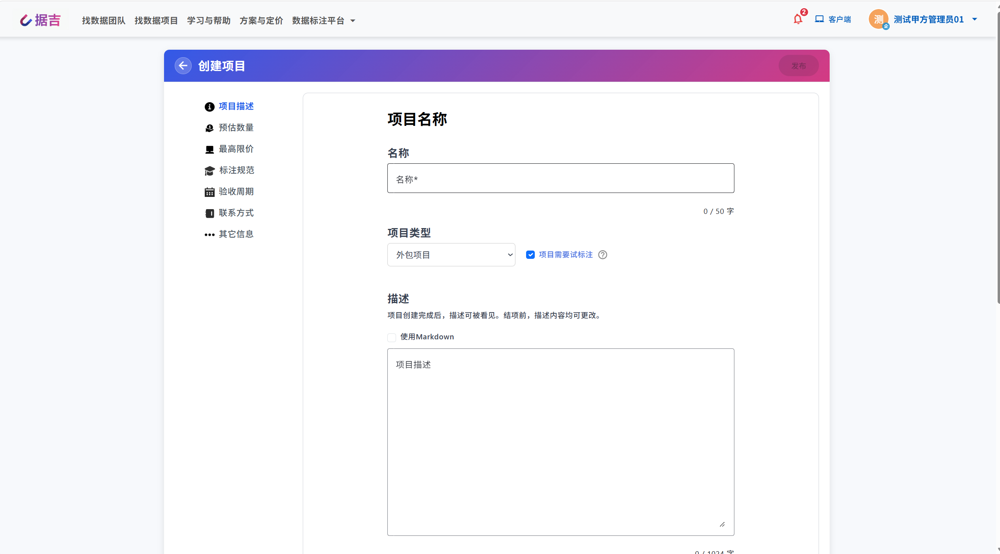
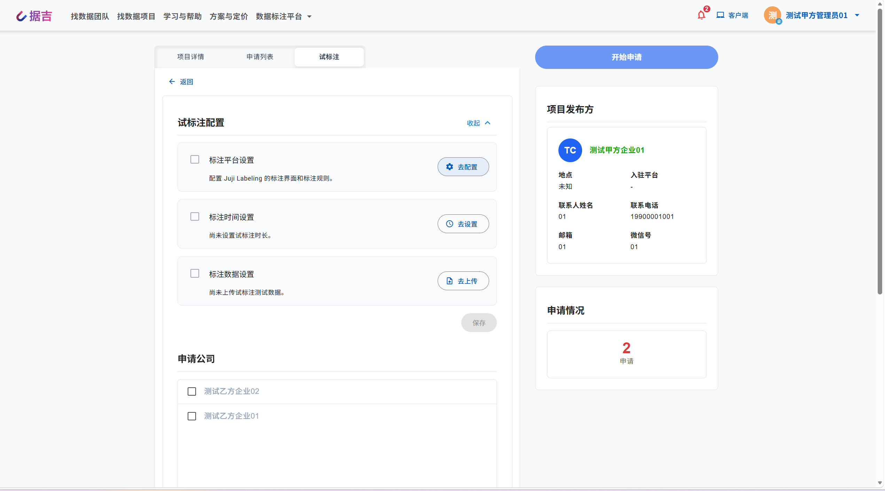
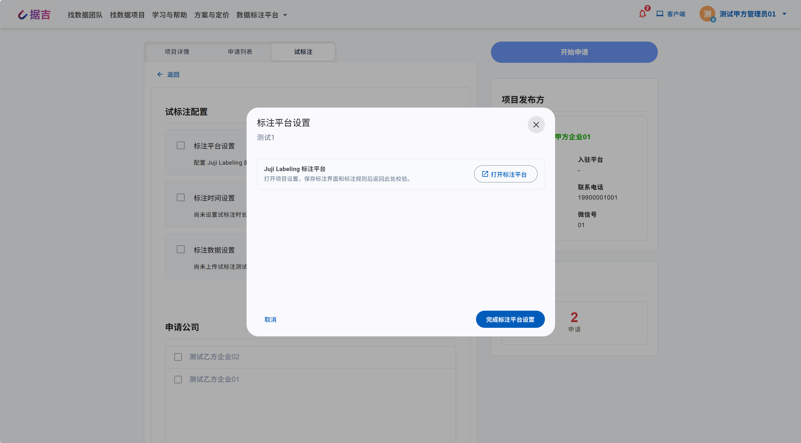

# 试标注操作指南

「试标注」是据吉网为**外包（协作）标注项目**提供的免费试用标注功能。甲方（发起方）在项目申请阶段，可邀请最多 3 家乙方（标注服务商）先行开展一轮限时试标注，用于验证乙方标注能力、核对标注规则与验收标准，再进入正式合同阶段。

> 想了解试标注的机制与定位，可先阅读概念文档：[试标空间 (Sandbox)](../concepts/sandbox.md)。

核心特点：

- **完全免费**：试标注无需席位、无需预付款；
- **限时进行**：单次时长 1～4 小时（由甲方设定），乙方开始后不可暂停，关闭页面计时仍会继续；
- **结果不可导出**：试标注的测试数据与标注结果不可下载、导出或转发。

## 适用角色与前置条件

- **甲方（发起方）**：甲方管理员，或个人项目所有者；
- **乙方（标注方 / 服务商）**：已申请该外包项目、并收到试标注邀请的企业 / 团队。

前置条件：

1. 项目为**外包（协作）项目**，且创建时已勾选「项目需要试标注」；
2. 项目处于**申请阶段**（尚未选定乙方、尚未签订合同）；
3. 平台已启用试标注功能。

## 甲方操作流程

### 1. 创建项目时开启试标注

1. 在创建外包（协作）项目时，勾选「项目需要试标注」选项；
2. 完成其余项目配置并正式发布项目。

> 注意：试标注设置**项目创建后不可修改**，请创建时确认是否开启。

### 2. 进入试标注配置

项目发布后，在项目详情页切换到「试标注」标签页（仅开启试标注的项目、且为甲方可见），打开「试标注配置」弹窗。弹窗内包含三个配置步骤，以及乙方选择与发起操作。

### 3. 标注平台设置

配置「Juji Labeling 标注平台」的标注界面与标注规则：

1. 点击「去配置」，打开项目设置；
2. 保存标注界面与标注规则；
3. 返回试标注弹窗，点击「完成标注平台设置」进行校验。

### 4. 标注数据设置

上传试标注测试数据。上传完成后，系统会显示已上传的「条测试数据」数量。

### 5. 标注时间设置

设置「单次试标注时长」。乙方开始试标注后不可暂停，时长可设置为 1～4 小时（整数小时）。

### 6. 选择乙方并发起

1. 在「申请公司」列表中选择试标注乙方（最多 3 家，数据与标注规则对所有参与公司保持一致）；
2. 点击「发起试标注」。

发起成功后，系统会向所选企业发送试标注邀请。

> 提示：无论本次选择多少家服务商，甲方**每周最多只能发起一次试标注**。

### 7. 查看试标注结果

试标注结束后，可点击「查看试标注结果」查看乙方的标注情况。

## 乙方操作流程

### 1. 接收试标注邀请

收到试标注邀请后，乙方登录平台，在项目「申请中」标签页可看到「试标注」入口。

### 2. 分配试标成员

乙方管理员通过「成员管理」（试标成员管理）为本次试标注分配标注成员。

> 注意：**试标项目最多只能分配一名员工**；试标注开始后将无法再修改项目成员。

### 3. 进入试标注

被分配成员点击「试标注」→「进入试标注」，系统弹出确认提示：

> 确认进入后，首次进入会立即开始计时；已经开始的试标注会继续当前计时。中途不可暂停，关闭页面也不会暂停计时。
>
> 试标注免费，无需席位和预付款；测试数据和标注结果不可下载、导出或转发。

确认后即进入标注平台并开始计时。

### 4. 开展标注

进入「Juji Labeling 标注平台」后，按照甲方设定的标注界面与标注规则完成标注任务并提交。

## 限制与注意事项

1. **计时规则**：首次进入立即开始计时，不可暂停，关闭页面计时仍会继续，请在时长内完成标注；
2. **免费与不可导出**：试标注免费（无需席位、预付款），测试数据与标注结果不可下载、导出或转发；
3. **发起频率**：甲方每周最多只能发起一次试标注；
4. **参与上限**：单次试标注最多支持 3 家公司；每家乙方最多分配 1 名试标成员；
5. **成员锁定**：试标注开始后无法修改项目成员。

## 常见问题 (FAQ)

**Q1：为什么无法发起试标注？**

- 请确认创建项目时已勾选「项目需要试标注」（创建后不可修改）；
- 请确认已依次完成「标注平台设置」「标注数据设置」「标注时间设置」并上传测试数据；
- 请确认已在「申请公司」中选择试标注乙方；
- 请确认本周尚未发起过试标注（每周限 1 次）。

**Q2：为什么无法进入试标注？**

- 试标注已提交、结束或超过作业期限；
- 当前企业尚未收到该项目的试标注邀请；
- 尚未完成试标成员分配。

**Q3：试标注开始后可以更换标注成员吗？**

不可以。试标注开始后将无法修改项目成员，请在开始前完成成员分配。

**Q4：试标注结果可以下载吗？**

不可以。测试数据与标注结果不可下载、导出或转发；正式合同阶段的标注数据才支持导出。

## 相关文档

- [快速上手：项目发布者 (甲方)](./buyer_guide.md)
- [快速上手：项目服务商 (乙方)](./vendor_guide.md)
- [快速上手：自标注模式](./self-annotated.md)
- [试标空间 (Sandbox)](../concepts/sandbox.md)
